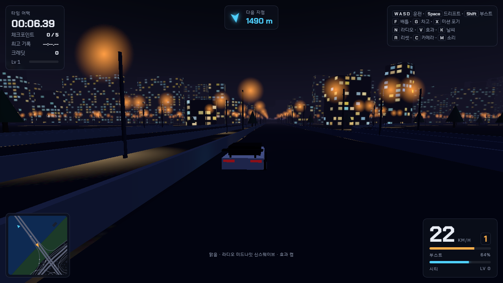
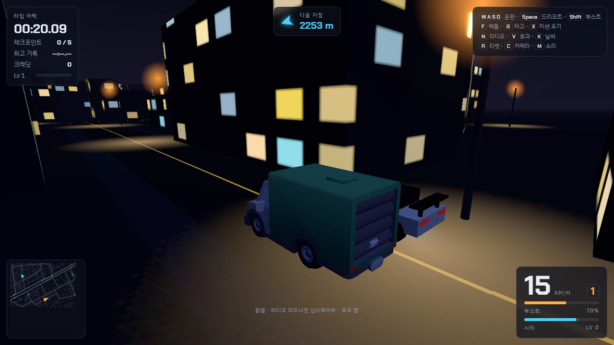
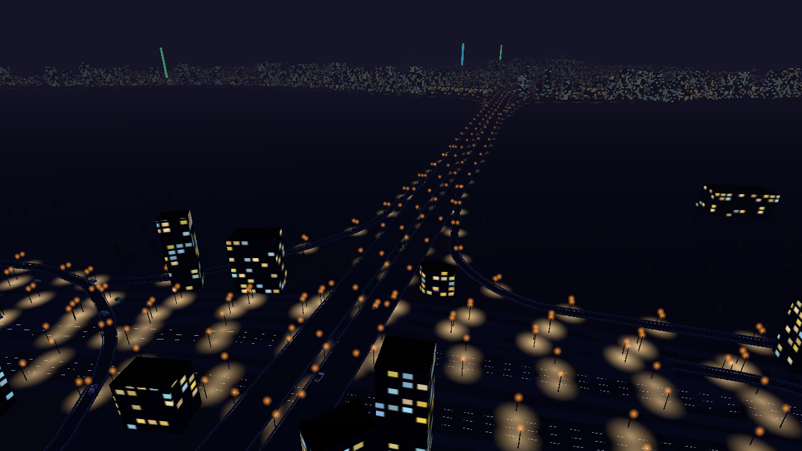
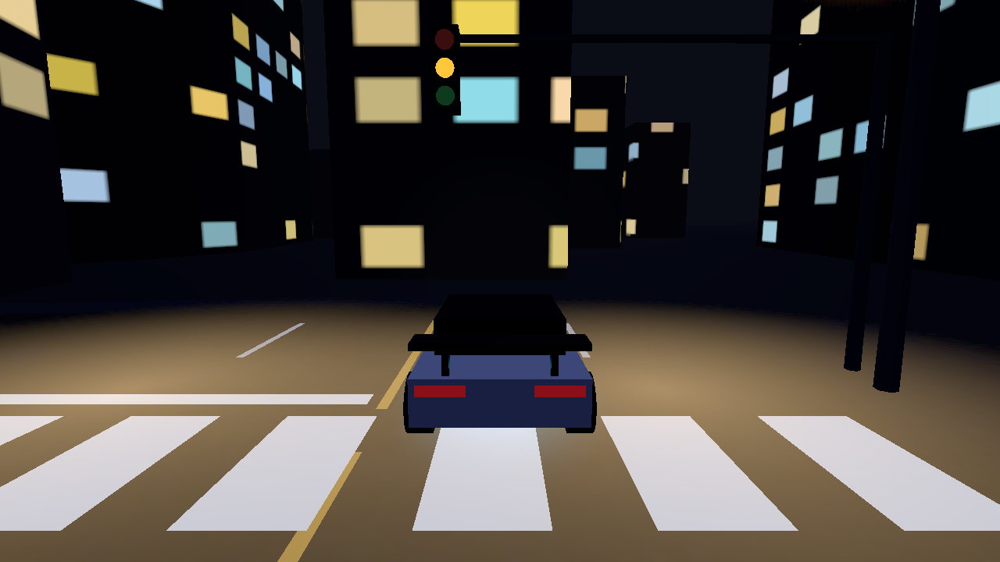

# 미드나잇 시티 (driveCity)

실제 서울(OpenStreetMap) 도로 위를 달리는 싱글플레이 웹 레이싱 게임이에요. Three.js + TypeScript + Vite 로 만들어요.

| 한남대교 | 도산대로 골목 |
| --- | --- |
|  |  |
|  |  |

## 실행

```bash
npm install
npm run dev      # http://localhost:5173
npm run build    # 타입 검사 + 번들 (dist/)
npm run preview  # 빌드 결과 확인
```

## 조작

| 키 | 동작 |
| --- | --- |
| W / ↑, S / ↓ | 가속, 브레이크·후진 |
| A D / ← → | 조향 |
| Space | 핸드브레이크 (드리프트, 부스트 충전) |
| Shift | 부스트 |
| F | 상향등. 근처 라이벌에게 배틀 신청 |
| G | 차고 (정차 중, 수배·미션·배틀 중이 아닐 때) |
| X | 미션 포기 |
| N / V / K / T | 라디오 방송국 전환 / 화면 효과(블룸) / 날씨 전환 / 시간 4시간 넘기기 |
| Tab 또는 미니맵 클릭 | 큰 지도 (내 위치 2.5배로 열림). 우클릭 드래그로 이동, 휠 또는 + − 버튼으로 확대, '전체'/'내 위치' 버튼, 좌클릭으로 닫기 |
| R / C / M | 리셋 / 카메라 전환 / 소리 |

HUD: 왼쪽 위 타임어택·크레딧, 위 가운데 목표 방향·거리, 아래 가운데 지금 달리는 길·동네, 왼쪽 아래 미니맵(목표까지 거리), 오른쪽 아래 반원 속도계(바깥 호 속도, 안쪽 호 회전수)·기어·부스트.

## 도시: 실제 서울 (OpenStreetMap)

- 지도는 1km 타일로 나뉘어 있고 **플레이어 주변 3×3 타일만** 자세히 만들어요(`docs/streaming-plan.md`). 그 바깥 두 고리(5×5·7×7)는 데이터만 받아 단색 상자 건물·큰길 띠·물만 그린 **저해상도**로 보여서(`world/far.ts`), 안개 너머에서 타일이 갑자기 나타나지 않아요. 타일 하나를 만드는 일은 제너레이터로 쪼개 **프레임당 4ms 씩** 나눠 처리하니(`world/tiles.ts`), 타일 경계를 넘어도 멈칫하지 않아요.
- 도로망·차선 수·일방통행·다리·건물 높이·한강·공원·동네 이름·신호등 위치를 OSM 에서 가져와요. 기본 지도 영역은 `public/map/seoul/index.json` 의 bbox 를 보세요.
- 차선 수는 OSM `lanes` 태그를 쓰고(방향당 최대 5), 태그가 없는 길(88%)은 등급별 기본값을 써요: 상·하행이 따로 그려진 대로의 한 조각은 primary 4·secondary 3·tertiary 2, 양방향 한 줄 길은 primary 3+3·secondary 3+3·tertiary 2+2, 동네길·골목 1+1 (`tools/build-map.mjs` DEFAULT_LANES).
- 인도: 큰길과 동네길은 연석(12cm) 위에 보도블록을 깔아요. 직진으로 이어지는 길은 하나의 띠로 잇고, 교차로에서는 교차하는 길의 인도 바깥까지 물러난 뒤 **모서리 보도**로 채워요(`city.ts` cornerPieces). 큰길엔 연석 안쪽 띠녹지(울타리)·가로수(보호덮개)·횡단보도 끝 볼라드가 있어요. 차가 인도에 올라가면 연석만큼 올라서요. 가로등은 큰길 양쪽 45m, 동네 간선 한쪽 55m 에만 있고 골목엔 없어요.
- 보행자는 인도 폴리라인·교차로 모서리 연결·횡단보도로 이어진 **보행 네트워크** 위를 걸어요. 길 끝에 닿으면 이어진 길 중 하나로 옮겨 가고, 횡단보도는 보행 신호가 파란불일 때만 건너요(빨간불이면 연석에서 서서 기다려요).
- 거리 요소: 1층 상가와 한글 간판, 옥상 광고판·실외기·물탱크, 아파트 동번호, 버스 정류장, 보행 신호등, 차선 화살표, 맨홀, 교차로 도로명 표지판. 밤엔 NPC 전조등·브레이크등. 실제 상호 간판은 타일마다 아틀라스(128칸씩)에 모아 그려요.
- 상·하행이 따로 그려진 대로 사이엔 중앙분리대(연석 띠 + 화단)를 세워요. 서울 중앙버스전용차로가 있는 길(강남대로·천호대로·송파대로 등, `graph.ts` MEDIAN_BUS_ROADS)은 1차로를, 가로변 전용차로가 흔한 큰길(테헤란로·봉은사로 등)은 바깥 차로를 파랗게 칠하고 '버스전용'을 써요. 버스는 그 차로로 다니고 일반 차는 피해요.
- 동네길·골목엔 길가에 주차된 차(Kenney 승용차)가 서 있고, 큰길 인도엔 쓰레기통·변압기함, 정류장엔 기다리는 사람이 있어요. 보행자는 머리·몸통·팔다리(캡슐) 부위별 인스턴스예요.
- 지하철 출입구(OSM subway_entrance)는 큰길 인도에 계단 구멍(스텐실로 지면·인도를 뚫음)·옹벽·계단·난간·유리 캐노피·표지판으로 서요.
- 교차로 바닥 화살표는 그 교차로에서 실제로 갈 수 있는 방향으로 정해요(`roads.ts` laneRoles: 1차로 좌회전, 바깥 직우/우회전 전용, 2차로면 직좌/직우). 교통 AI 도 같은 규칙으로 회전 차선을 잡아요.
- 랜드마크는 이름으로 알아보고 전용 모양으로 그려요: 롯데월드타워(16단 곡면 테이퍼 + 크라운 + 첨탑), 잠실주경기장·야구장(스탠드 벽 + 지붕 링 + 필드), 잠실실내체육관(돔), 롯데월드 매직아일랜드(첨탑 성). 외부 모델은 무료·CC 라이선스로 구할 수 있는 게 없어 절차 생성이에요. 그 밖의 180m 넘는 타워도 위로 좁아지는 유리 타워에 첨탑을 얹어요.
- 외벽은 ambientCG CC0 사진 질감(유리·오피스·벽돌)과 절차 생성(한국식 아파트, 1층 상가, 한글 간판, 옥상 광고판)이고, 같은 질감이라도 동마다 틴트(`city.ts` TINTS)를 달리 찍어요. 벽 밑동은 때가 타고(월드 y 기준), 옥상엔 파라펫, 상가엔 차양이 붙어요. 유리 커튼월·상가 유리·차 도장은 하늘 환경맵을 비춰요.
- 바닥 질감: 아스팔트·보도블록(사각 콘크리트 타일)·잔디(공원·중앙분리대·경기장)·수피는 ambientCG PBR(색·노멀·거칠기)이고, 도로·보도·잔디·차선 페인트엔 월드 좌표 얼룩 노이즈(`render/materials.ts` withGrime)를 곱해 같은 질감이 반복돼 보이지 않게 하고 차선은 군데군데 닳아 보여요.
- 나무는 절차 생성(`render/trees.ts`): 수피 질감 줄기 + 잎 뭉치 알파 카드 20여 장을 타원체에 흩고 법선을 바깥으로 향하게 해 한 덩어리처럼 빛을 받아요. 플라타너스·느티나무·은행나무(가로수), 소나무·벚나무(공원) 5종 × 2변형. 화단은 빽빽한 잎 질감이에요.
- 렌더 파이프라인(`render/scene.ts`): 장면 → GTAO 주변광 차폐(반해상도, 건물 밑동·연석·차 밑 접촉 그림자) → ACES 톤매핑·sRGB(OutputPass) → 블룸(톤매핑 뒤, 밝은 창문·네온·가로등만) → 컬러 그레이딩(콘트라스트·채도·비네팅). 하늘은 대기 산란 모델(three Sky, 절차 구름)이고 같은 하늘을 PMREM 으로 구워 환경맵으로 써요(해 높이가 바뀔 때마다 다시 굽고, 태양 원반은 빼고 구워요). 햇빛 그림자는 4096 섀도맵. 화면 효과(F)를 끄면 AO·블룸이 꺼져요.
- 기본 지도는 서초·강남·송파·강동·광진·용산·성동 7개 구(20×15km, 타일 304개)예요. 건물 폴리곤·층수·이름은 국토부 V-World 건물통합정보, 정류장·역·상호는 OSM POI 에서 왔어요.
- **지형**: Copernicus GLO-30 DEM(30m, 무료)을 타일마다 25m 격자 높이맵(`tile.hm`, `tools/add-dem.mjs`)으로 구워 한강 수면을 0m 로 둬요. 남산·우면산·응봉산·청계산 비탈과 강남의 완만한 오르내림이 그대로 나오고, 차는 노면 높이를 따라 오르내려요(오르막에서 느려짐). 지상 도로는 DEM 을 100m 이동 평균으로 고른 뒤 그 폭 안의 지형을 노면 높이로 눌러(스탬핑, 차도 안쪽은 8cm 아래) 지형이 노면을 뚫거나 도로가 뜨지 않아요. 고가·지하차도는 양끝 지형을 직선 보간한 바닥 위에 레벨 높이를 얹어 다리가 강바닥을 따라 처지지 않아요(`graph.heightAt`). 인도·연석·화단·중앙분리대는 5~6m 마다 지형을 따라가고, 건물은 고리 꼭짓점 중 가장 높은 지형에 앉히고 낮은 쪽은 콘크리트 기초로 메워요. 도로·건물에서 먼 땅(산지·공터)은 숲 마스크(`tile.gm`)로 잔디를 깔고 나무를 흩어요. 공원은 지형 메시의 잔디 마스크로 그려요.
- **레이시티 톤**(2026-10-23, 실제 주행 영상을 기준으로): 밝고 따뜻한 하이키 낮(노출 0.9, 낮은 대비·비네팅), 대기 산란 하늘에 셰이더 게인(0.12)을 곱해 파란 하늘·흰 구름이 날아가지 않게 하고 환경맵 세기로 보상, 햇빛 글레어 스프라이트, 밝은 회베이지 아스팔트, 굵은 차선·횡단보도, 붉은 버스전용차로.
- **사진 파사드 합성기** (`render/facades.ts`): CC0 사진 질감(타일·벽돌·화강석·플라스터·콘크리트)을 캔버스에 층별로 합성해 근린상가 14종·오피스 8종·아파트 6종·1층 상가 8종을 시작 화면에서 만들어요. 창문(하늘 반사·알루미늄 틀·커튼), 실외기, 배관, 창턱 오염 줄무늬, 화강석 띠, 1층은 유리 진열·셔터·화강석 기단·라이트박스 간판(밤 발광). 상가는 층마다 간판 1~2개와 벽에서 튀어나온 세로 돌출 간판이 붙어요.
- **도로 시설**: 고속화도로(motorway) 지상 구간 양옆 방음벽(베이지 패널 + 기둥), 간선(trunk)엔 가드레일. 지하차도 옹벽·천장은 타일 사진이고 덮인 구간엔 8m 마다 천장 조명. 고속화도로엔 인도가 없어요. 지하 철도(OSM tunnel)는 그리지 않아요.
- **효과**: 드리프트 타이어 연기(빌보드 입자), 고속·부스트 때 화면 가장자리 속도선(`#rush`).
- **목적지 길안내**: 큰 지도(Tab)에서 **우클릭**한 지점이 목적지가 돼요. 전역 내비 그래프(`public/map/seoul/nav.json`, 등급 4 이하 도로 1.2만 노드, `tools/build-nav.mjs`)로 아직 로드되지 않은 먼 곳까지 경로를 찾고, 미니맵·큰 지도에 분홍 경로선, 화면 위 화살표는 경로 위 40m 앞 지점(다음 갈림길)을 가리키며 남은 경로 길이를 표시해요. 경로에서 120m 넘게 3초 벗어나면 다시 찾고, 25m 안에 들어오면 도착. X 로 취소.
- **멈칫거림 진단 (P 키)**: 프레임 시간·그리기 호출·셰이더 프로그램 수·타일 상태·JS 힙과, 70ms 넘긴 프레임마다 "그때 무엇이 돌았는지"(타일 생성 단계, 셰이더 컴파일 개수, 타일 수신)를 적은 로그가 뜹니다(콘솔에도 `[perf]`). 셰이더는 시작 화면에서 모든 재질 조합을 한 번 그려 미리 컴파일해요(`render/warmup.ts`). three.js 는 장면의 **조명 개수가 바뀌면 모든 셰이더를 다시 컴파일**하므로 NPC(경찰 경광등·택시 갓등)에는 점광원을 달지 않고 가산 혼합 원판으로 대신해요 — 예전엔 경찰차가 생기고 사라질 때마다 수백 개 셰이더가 재컴파일돼 1초 가까이 멈췄어요.
- **골목 상세 LOD**: 길가 주차 차량과 실제 상호 간판은 플레이어와 350m 안의 타일에만 올리고 650m 넘게 멀어지면 내려요(`tiles.ts` DETAIL_NEAR/FAR, `city.buildExtras`). 도로·건물·가로수 같은 기본 모습은 3×3 타일 전부에 있어요.
- 고가·다리(OSM bridge/layer)는 레벨마다 7m·12.5m… 위에 상판·난간·교각을 세우고, 지하차도(tunnel)는 6.5m 아래로 옹벽 사이를 내려가 천장 아래로 들어가요. 양끝은 6% 경사 램프로 지상과 이어지고(`tools/build-map.mjs` 노드 높이 계산, `graph.heightAt`), 차는 노면 높이·피치를 따라가며 오르막에서 느려져요. 고가 위 차와 아래 차는 서로 부딪히지 않아요. bridge 태그 없는 연결로(link)가 고가 중간에서 갈라지면 고가를 끌어내리지 않고 연결로가 8% 램프로 내려와요.
- 중앙 황색 실선, 차선 점선, 신호 교차로의 정지선·횡단보도·신호등. 신호 없는 골목 교차로는 먼저 온 차가 지나가요.
- 저층 건물엔 네온 간판, 55m 넘는 건물엔 항공 장애등.
- 하루가 14분에 한 바퀴 돌아요(16시 시작). 낮엔 햇빛과 외벽, 노을엔 주황 하늘, 밤엔 창문·가로등·네온이 켜져요. T 로 시간을 넘길 수 있어요.
- 날씨가 2~3분마다 바뀌어요. 비가 오면 안개가 짙어지고 노면이 젖어요.

### 다른 지역으로 바꾸기

```bash
npm run map:fetch -- 37.44 126.95 37.575 127.18      # south west north east. 2.2km 타일로 나눠 받고, Overpass 가 바쁘면 알아서 재시도해요
# 지형: Copernicus DEM 1° 타일(.tif, https://copernicus-dem-30m.s3.amazonaws.com/ )을 data/dem/ 에 받은 뒤
node --max-old-space-size=8192 tools/add-dem.mjs public/map/seoul data/dem   # 타일마다 hm/gm 을 써 넣어요 (맵 재빌드 후 다시 실행)
npm run map:build -- data/osm-raw.json public/map/seoul   # 1km 타일 + index.json + overview.png
```

넓은 영역은 미러별로 병렬로 받을 수 있어요: `TILE_SHARD=0/3`, `1/3`, `2/3` 으로 세 프로세스를 띄운 뒤, 다 끝나면 shard 없이 한 번 더 실행해 합쳐요. 받은 타일은 `data/tiles/<bbox>/` 에 남아 이어받아요. 사내망처럼 인증서 폐기 확인이 막힌 곳을 위해 `curl --ssl-no-revoke` 로 받아요.

### 더 실제에 가깝게 (선택)

같은 bbox 로 아래를 받아 두면 `map:build` 가 자동으로 읽어요.

```bash
node tools/fetch-pois.mjs 37.44 126.95 37.575 127.18          # OSM 버스 정류장·지하철역·상점·편의시설 → data/pois-<bbox>.json
VWORLD_KEY=발급키 node tools/fetch-vworld.mjs 37.44 126.95 37.575 127.18   # 국토부 건물통합정보(층수·이름·전수 폴리곤) → data/vworld-<bbox>.json
```

- POI 가 있으면 버스 정류장이 실제 위치에 서고, 가게 앞에 실제 상호 간판이 붙고, 지하철 출입구 표지가 생겨요.
- V-World 건물이 있으면 OSM 건물·보강 건물 대신 전수 건물 폴리곤을 쓰고 층수로 높이를 정해요. 키는 [vworld.kr](https://www.vworld.kr) 에서 무료 발급(오픈API 인증키). 키는 환경변수로만 쓰고 저장소에 넣지 마세요.

## 교통

- 타일마다 도로 1km 당 1.6대를 바탕으로 깔고, 플레이어 주변 380m 에 55대는 보이게 채워요(전체 360대 상한, 먼 차부터 정리). 승용차·택시·간선·지선·마을·광역버스 비율은 `vehicle/kinds.ts`. 경찰 3, 라이벌 3.
- 신호를 지키고, 느린 차는 옆 차선이 비었을 때 추월하고, 우회전 전에는 바깥 차선으로 옮겨요. 좌회전·유턴은 맞은편 차가 지나갈 때까지 정지선에서 기다리고, 교차로 너머가 막혀 있으면 들어가지 않아요(30% 는 꼬리물기를 해요).
- 버스는 정류장에 5~9초 서고, 그동안 대기소에서 버스 문으로 사람이 타고 내려요.
- 앞이 갑자기 막히면(끼어들기) 세게 밟고 경적을 울려요. 경적은 내 차 기준 방향으로 들려요.
- 라이벌과 추격 중인 경찰은 신호를 무시해요.

## 게임 루프

1. 파란 기둥 5곳 타임어택 → 완주 500 크레딧 (최고 기록 +300)
2. 초록 기둥(미션 거점 4곳)에서 미션: 퀵 배달, 택시 손님(충돌하면 만족도 하락), 스프린트 3구간. 거리에 따라 보상
3. 라이벌(Lv1~3) 배틀 승리 → 800 / 1,600 / 3,200 크레딧
4. 신호 위반·사고를 내면 수배 ★ 가 오르고 경찰이 쫓아와요. 경찰 옆에 멈추면 검거(벌금), 150m 이상 떨어져 10초 버티면 도주 성공(보너스)
5. 차고에서 차량 구매, 엔진·타이어·서스펜션·부스터 튜닝, 도색·언더글로우
6. 미션·배틀·도주로 XP 를 모아 레벨 업

진행 상황은 브라우저 `localStorage` (`dc-save`) 에 저장돼요.

## 구조

```
src/
  config.ts          도로 폭·차선, 보상 상수
  main.ts            초기화와 게임 루프, 신호 위반 감지
  input.ts           키보드·터치 입력
  audio.ts           합성 엔진음·사이렌
  radio.ts           WebAudio 로 만드는 라디오 두 방송국
  camera.ts          추적 카메라
  render/            렌더러(블룸), 캔버스 텍스처, 비
  world/             맵 파일 로더, 도로 그래프(다익스트라·공간 색인), 차선 경로·교차로 곡선, 건물 폴리곤 충돌, 도시 생성, 신호등, 마커
tools/
  fetch-osm.mjs      Overpass 에서 OSM 원본 받기
  build-map.mjs      원본 → 게임 맵 (도로 그래프 분할, 차선 추정, 건물 높이, 한강·공원 폴리곤 자르기)
  vehicle/           플레이어 물리·모델, 차종, 상자 모델, 외부 모델 로더, 차량 카탈로그·튜닝 스탯
  ai/                일반 교통·버스·라이벌·경찰 AI (차선 변경, 신호 준수, 추격)
  game/              저장(XP·설정), 타임어택, 배틀, 수배, 미션, 지명
  ui/                HUD, 미니맵, 차고
```

밸런스는 `src/vehicle/stats.ts` (차량·부품), `src/vehicle/kinds.ts` (교통 차종·대수), `src/ai/traffic.ts` (라이벌 속도·보상), `src/game/wanted.ts` (수배 열·벌금), `src/game/missions.ts` (미션 보상), `src/config.ts` (보상) 에서 조정해요.

## 3D 모델

교통 차량·경찰·라이벌은 `public/models/` 의 외부 모델(glb/fbx)로 그리고, 파일이 없으면 상자 모델로 돌아가요. 모델을 추가·교체하는 방법은 `public/models/README.md` 를 보세요.

- 승용차·택시·경찰·라이벌: [Kenney Car Kit](https://kenney.nl/assets/car-kit) (CC0)
- 버스: [Free Low Poly Vehicles Pack by Rgsdev](https://opengameart.org/content/free-low-poly-vehicles-pack) (CC0)

## 다음 후보

- 현대·기아 실제 차종 모델 (Sketchfab 등에서 받아 `public/models/` 에 넣기). 플레이어 차는 아직 상자 모델
- 랜드마크 외부 모델 (지금은 초고층을 절차 생성 타워로)
